<h1 align="center">Hi 👋, I'm Diego Latouche</h1>
<h3 align="center">Full-stack developer passionate about building scalable web applications.</h3>

- 📫 Reach me at **latoudiego@gmail.com**

<!-- cool-readme:start -->
<!-- Cards by github-cool-readme: https://github.com/pedrocatalao/github-cool-readme -->

<picture>
  <source media="(prefers-color-scheme: dark)" srcset="https://raw.githubusercontent.com/LatouCR/LatouCR/cards/summary-dark.svg">
  
</picture>
<picture>
  <source media="(prefers-color-scheme: dark)" srcset="https://raw.githubusercontent.com/LatouCR/LatouCR/cards/languages-dark.svg">
  
</picture>

<picture>
  <source media="(prefers-color-scheme: dark)" srcset="https://raw.githubusercontent.com/LatouCR/LatouCR/cards/about-dark.svg">
  
</picture>
<picture>
  <source media="(prefers-color-scheme: dark)" srcset="https://raw.githubusercontent.com/LatouCR/LatouCR/cards/repos-dark.svg">
  
</picture>

<!-- cool-readme:end -->
